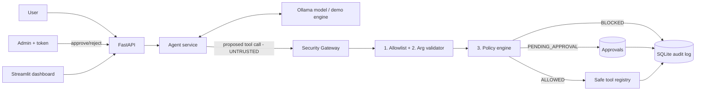

# 🛡️ AgentShield AI

A **security gateway for local AI agents**. An LLM (via Ollama) may *propose* tool calls, but it never executes anything.
Every proposed call is treated as an **untrusted request** and must pass through AgentShield: allowlist → strict argument validation → policy → (optional) human approval → execution → audit log.

> Educational, production-*inspired* project. It is **not** production-ready - see [docs/SECURITY.md](docs/SECURITY.md).

## Problem
Agents that can call tools are vulnerable to prompt injection and model mistakes. If model output is executed directly, a single bad completion can leak data or cause damage. AgentShield puts a deterministic, testable security boundary **in backend code** (not in the prompt) between the model and your tools.

## Features
- Tool registry allowlist; unknown tools rejected (default deny)
- Strict Pydantic argument schemas (`extra="forbid"`), range/pattern checks
- Policy engine: `public` → allow, `approval_required` → human approval, `restricted` → block; env overrides
- Human approval workflow: expiry, single-use atomic claim (replay-proof), admin token
- SQLite audit log with secret redaction, filtering, pagination
- Ollama integration: health check, timeout, bounded loop (max 5), safe failure
- Deterministic **demo mode** (no Ollama needed) with 7 scenarios
- Streamlit security dashboard (7 tabs) · FastAPI + OpenAPI docs · 60 pytest tests

## Architecture


## Prerequisites
Python 3.11+, (optional) [Ollama](https://ollama.com/download) for real-model mode.

## Setup (Windows PowerShell)
```powershell
cd agentshield-ai
python -m venv .venv
.\.venv\Scripts\Activate.ps1          # if blocked: Set-ExecutionPolicy -Scope Process Bypass
pip install -r requirements.txt
Copy-Item .env.example .env
python -c "import secrets; print(secrets.token_urlsafe(24))"   # paste result into AGENTSHIELD_ADMIN_TOKEN in .env
```
The SQLite database is created automatically on first start.

### Run (two PowerShell terminals, venv activated in each)
```powershell
# Terminal 1 - backend  (http://127.0.0.1:8000/docs)
python run.py
```
```powershell
# Terminal 2 - dashboard (http://localhost:8501)
streamlit run dashboard/app.py
```
Paste the same admin token into the dashboard sidebar to use the Approval Queue.

### Demo mode (default, no Ollama)
`AGENTSHIELD_DEMO_MODE=true` → a deterministic engine proposes the calls (clearly labelled `demo_engine`, never claimed to be an AI).

### Real Ollama mode
```powershell
winget install Ollama.Ollama         # or download from https://ollama.com/download
ollama pull llama3.1:8b
ollama serve                         # skip if the Ollama app is already running
```
Set `AGENTSHIELD_DEMO_MODE=false` in `.env` and restart the backend. Check `GET /health/ollama`.
(The 7 dashboard scenarios always use the deterministic engine so they work in either mode.)

## API examples (PowerShell)
```powershell
Invoke-RestMethod http://127.0.0.1:8000/health
Invoke-RestMethod -Method Post http://127.0.0.1:8000/api/agent/run -ContentType application/json -Body '{"scenario":5}'
$h = @{ "X-Admin-Token" = "<your token>" }
Invoke-RestMethod http://127.0.0.1:8000/api/approvals -Headers $h
Invoke-RestMethod -Method Post http://127.0.0.1:8000/api/approvals/<id>/approve -Headers $h
```
More in [docs/API_EXAMPLES.md](docs/API_EXAMPLES.md).

## Security scenarios
| # | Scenario | Result |
|---|----------|--------|
| 1 | Public status | ALLOWED + EXECUTED |
| 2 | Search fictional records | ALLOWED + EXECUTED |
| 3 | Unknown tool `delete_all_files` | BLOCKED |
| 4 | Invalid + extra arguments | BLOCKED |
| 5 | Sensitive report | PENDING_APPROVAL |
| 6 | Restricted action | BLOCKED |
| 7 | Simulated model failure | Safe error, nothing runs |

## Rejected vs pending vs failed
- **BLOCKED**: policy/validation said no. Nothing ran.
- **PENDING_APPROVAL**: waiting for a human. Nothing ran yet.
- **FAILED** (`execution_status`): authorized, but the tool raised an error while running.

## Tests
```powershell
python -m pytest -q
```
No Ollama needed (it is mocked).

## Troubleshooting
- *Dashboard says backend unreachable* → start `python run.py`; check sidebar URL.
- *401 on approvals* → set `AGENTSHIELD_ADMIN_TOKEN` in `.env`, restart backend, use same token in sidebar.
- *503 MODEL_UNAVAILABLE* → Ollama not running or model not pulled (`ollama pull llama3.1:8b`), or use demo mode.
- *Model never calls tools* → small models are inconsistent at tool calling; use demo scenarios.

## Security limitations (short)
Shared dev token (not real identity/RBAC), no rate limiting, no TLS, SQLite audit log is not tamper-proof, tools have no execution timeout, demo "user" is fixed. See [docs/SECURITY.md](docs/SECURITY.md).

## Structure
```
app/ (main, config, schemas, database, container)
  agent/ (service, ollama_client)  security/ (gateway, policies, validators)
  tools/ (registry, safe_tools)    services/ (audit, approvals)
dashboard/app.py   tests/   docs/   run.py   .env.example
```
